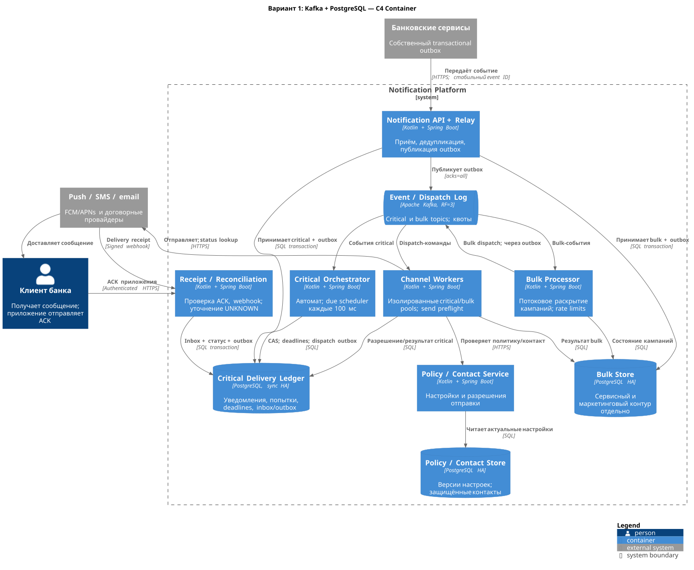
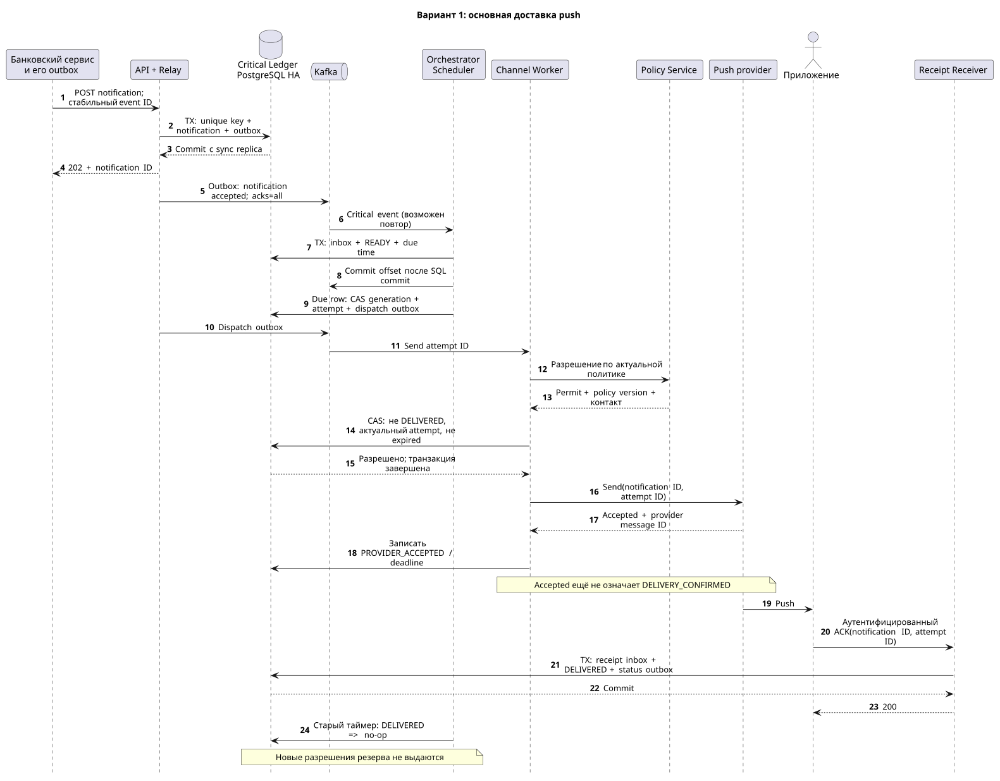
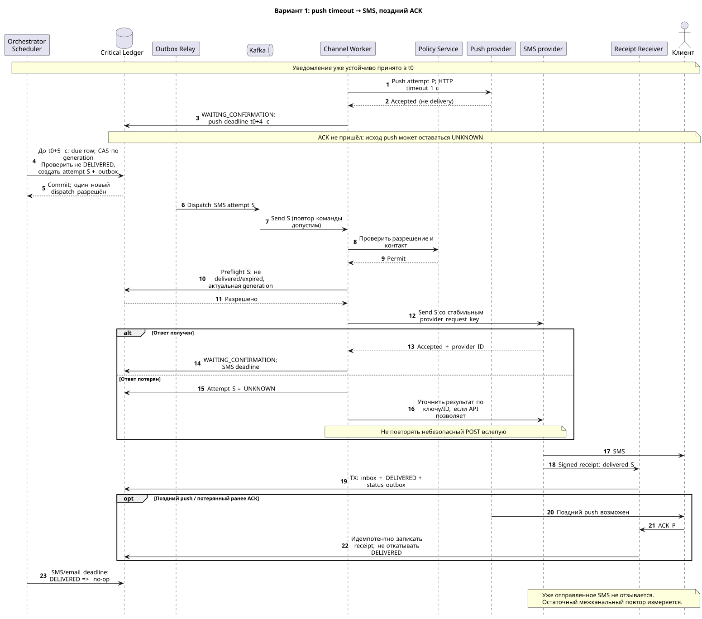
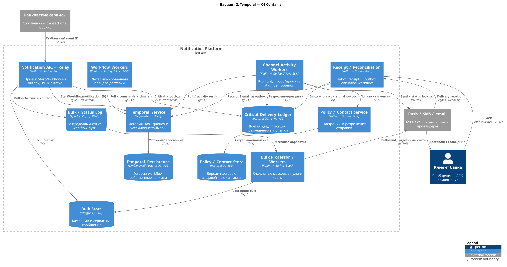
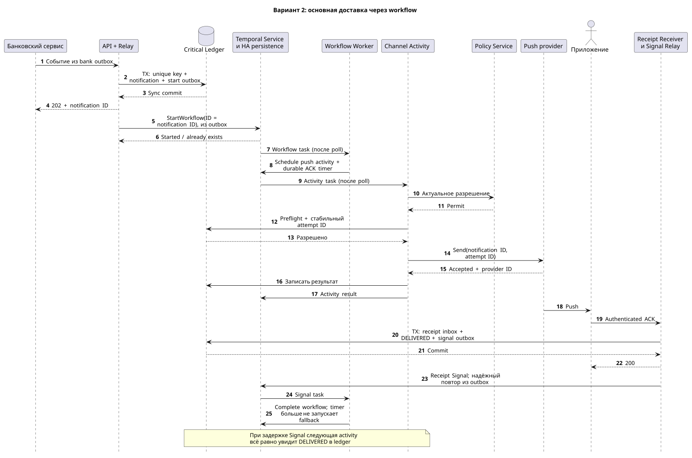
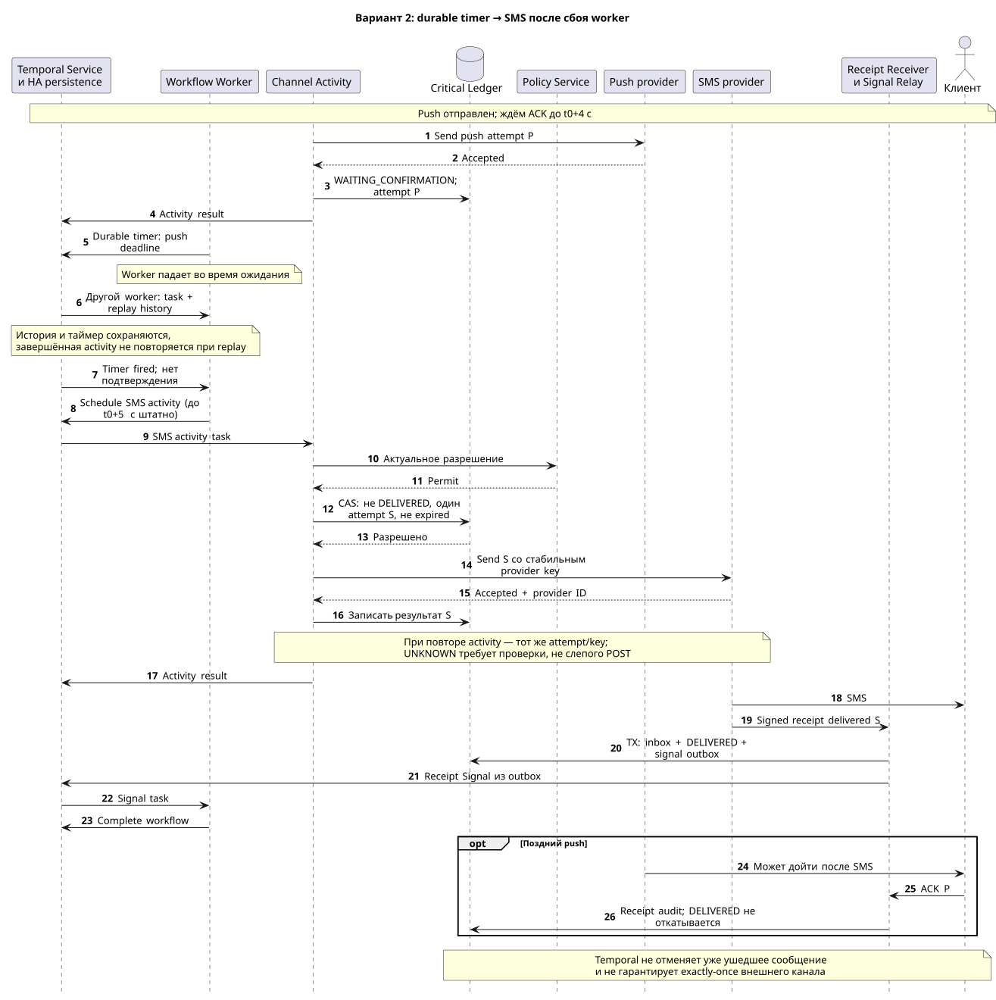

# RFC: Гарантированная доставка критичных уведомлений с кросс-канальным failover

| Метаданные | Значение |
| --- | --- |
| Статус | DESIGN — архитектурное предложение, реализация не выполнена |
| Автор | Михаил Осипов |
| Ответственный | Михаил Осипов, в рамках учебной работы |
| Бизнес-заказчик | Владелец Notification Platform, роль в модельном банке; конкретное лицо не назначено |
| Ревьюеры | Не назначены; перед запуском нужны владельцы продуктовых сервисов, SRE и безопасность |
| Дата создания | 2026-11-17 |
| Дата обновления | 2026-11-17 |

## Оглавление

1. [Контекст](#контекст)
2. [Продуктовый анализ](#продуктовый-анализ)
3. [Пользовательские сценарии](#пользовательские-сценарии)
4. [Статистика](#статистика)
5. [Требования](#требования)
6. [Варианты решения](#варианты-решения)
7. [Сравнительный анализ](#сравнительный-анализ)
8. [Выводы](#выводы)
9. [Связанные задачи](#связанные-задачи)
10. [Приложения](#приложения)

## Контекст

Продуктовые команды онлайн-банка самостоятельно отправляют уведомления. В результате нет единого статуса доставки, сообщения задерживаются и повторяются. Особенно опасна недоставка информации о переводе или списании: клиент может не заметить нежелательную операцию и потерять доверие к банку.

В рамках общей Notification Platform нужно спроектировать подсистему, которая сохраняет принятое критичное уведомление, пытается доставить его через доступные каналы и автоматически переключается при отказе или отсутствии подтверждения. Отправитель не должен реализовывать эти правила заново.

**Область RFC:** транзакционные сообщения о совершившихся операциях и безопасности; push, SMS, email; управление попытками, подтверждениями, failover и восстановлением. Общая платформа также обслуживает сервисные и маркетинговые сообщения: их присутствие существенно для изоляции нагрузки и настроек.

**Вне области:** авторизация платежа, OTP, создание маркетингового контента, подробная схема всех банковских сервисов и полноценная реализация. Встроенная история уведомлений — дополнительный способ увидеть событие, но не подмена доставки через один из трёх заданных каналов.

Архитектура рассчитана на один регион с тремя зонами доступности. Потеря одной зоны входит в модель отказов. Одновременная потеря региона, всех верифицированных контактов или всех внешних каналов исключает безусловную доставку. Отдельное региональное DR требует другого решения и бюджета.

## Продуктовый анализ

| Участник | Потребность | Ценность предлагаемого изменения |
| --- | --- | --- |
| Клиент банка | Быстро узнать о движении денег, управлять некритичными сообщениями | Меньше пропущенных событий и раздражающих повторов |
| Продуктовая команда | Передать событие один раз и видеть результат | Единый контракт без собственных таймеров и резервных каналов |
| Поддержка | Объяснить клиенту, что случилось с сообщением | История попыток и разделение «принято», «доставлено», «прочитано» |
| SRE | Обнаружить отказ провайдера и накопление очереди | Отдельные SLI по всей цепочке и понятный порядок восстановления |
| Бизнес | Сохранить доверие, контролировать стоимость | Дешёвый push-first в штатном режиме и управляемый SMS-резерв |

Цели из задания — относительный рост retention на 15%, снижение нормированной частоты жалоб на 30% и надёжная критичная доставка. Определение метрик и способ оценки результата даны в [requirements.md, §1](requirements.md#1-контекст-цели-и-допущения). Цели retention и жалоб оцениваются после внедрения; RFC не заявляет, что они уже достигнуты.

Пользователь может отключить маркетинг и сервисные напоминания по категориям и каналам. Сообщения о деньгах и безопасности целиком не отключаются; можно выбрать первый канал. Это продуктовая политика этой работы, которую до production нужно согласовать. По умолчанию используется push → SMS → email. Если пользователь явно выбрал SMS или email первым, предпочтение выполняется, а остальные доступные каналы образуют резерв. Физически недоступные или неверифицированные контакты пропускаются.

При конфликте целей выбираем сохранность и безопасность, затем доставку критичного сообщения, затем снижение повторов и стоимость. Поэтому аварийный SMS-расход вызывает сигнал, но не останавливает критичную доставку.

## Пользовательские сценарии

| Приоритет | Тип сценария | Действующее лицо | Сценарий |
| --- | --- | --- | --- |
| MUST HAVE | Основной | Продуктовый сервис | После фиксации банковского события передаёт уведомление со стабильным ключом; получает ID после устойчивого сохранения. |
| MUST HAVE | Основной | Клиент | Получает push; приложение подтверждает обработку, резервные каналы больше не запускаются. |
| MUST HAVE | Failover | Клиент | Push отказал или подтверждение не пришло к дедлайну; платформа обращается к SMS, затем при необходимости к email. |
| MUST HAVE | Повтор | Продуктовый сервис | Не получил ответ на запрос приёма и повторил его с тем же ключом; получает прежний ID. |
| MUST HAVE | Восстановление | SRE | После сбоя воркера/зоны обработка принятого сообщения возобновляется из сохранённого состояния. |
| MUST HAVE | Неопределённый исход | Поддержка | Провайдер мог отправить SMS, но ответ потерян; история показывает UNKNOWN, проверку статуса и принятое решение о резерве. |
| MUST HAVE | Настройки | Клиент | Меняет первый канал критичных сообщений; новые разрешения отправки учитывают изменение, уже принятые провайдером сообщения могут прийти. |
| MUST HAVE | Массовый отказ | SRE | Все каналы недоступны; сообщения сохраняются, происходит контролируемый retry и открывается инцидент. |
| SHOULD HAVE | Аналитика | Владелец платформы | Сравнивает стоимость, задержки и долю резервных отправок до и после изменения политики. |
| COULD HAVE | Оптимизация | Владелец платформы | После накопления статистики настраивает время ожидания отдельно для сегментов устройств в пределах согласованного SLO. |

MUST HAVE — обязательно для запуска критичного контура; SHOULD HAVE — желательно для полноценной эксплуатации; COULD HAVE — последующая оптимизация. Сами метрики доставки и расходов MUST HAVE, дополнительная продуктовая аналитика SHOULD HAVE.

## Статистика

Из задания известны MAU 10 млн, DAU 3 млн, Peak Concurrent Users 300 тыс.; частоты 2 транзакционных, 3 сервисных и 5 маркетинговых уведомлений на пользователя в день. Фактических измерений существующей системы не предоставлено.

| Величина | Базовая оценка | Основание |
| --- | ---: | --- |
| Все уведомления | 30 млн/сутки | 3 млн DAU × 10 |
| Критичные | 6 млн/сутки; 69,44/с в среднем | 3 млн × 2 |
| Обычный суммарный пик | 3 472,22/с | Допущение ×10 к среднему |
| Дополнительная кампания | 555,56/с | 1 млн за 30 минут |
| Пик с кампанией | 4 027,78/с | Сумма двух предыдущих строк |
| Критичный стресс | 5 000/с | Допущение: 300 тыс. событий за минуту |
| Суммарный стресс | 8 333,33/с | Критичный стресс + остальные пики и кампания |
| Целевая мощность | 5 000/с штатно; 10 000/с на 15 минут | С запасом к рассчитанным профилям |
| Метаданные, 30 дней | 1,8 TB без реплик и индексов | Допущение 2 KB на уведомление |

Полный [расчёт](capacity.md) включает retries, квоты SMS, backlog, диски, стоимость и интерпретацию 100 млн/сутки. Все приведённые мощности — цели для испытаний, а не результаты бенчмарка.

## Требования

### Функциональные требования

RFC использует общие требования [пунктов 1–3 работы](requirements.md). Обозначения сохраняются, чтобы проследить связь от бизнес-целей до решения.

| № | Приоритет | Обозначение | Требование к подсистеме |
| --- | --- | --- | --- |
| 1 | MUST HAVE | FR-01, FR-05 | Единый ID уведомления; повтор исходного события возвращает прежний ID и не начинает новый процесс. |
| 2 | MUST HAVE | FR-02, FR-07 | Критичная доставка не ждёт завершения маркетинговой кампании. |
| 3 | MUST HAVE | FR-03, FR-10 | Учитываются обязательность категории, порядок каналов, отключения и ограничения частоты некритичных сообщений. |
| 4 | MUST HAVE | FR-04, FR-05 | Резерв при отказе/тайм-ауте; после подтверждения не создаются новые попытки, ещё не переданные каналам. |
| 5 | MUST HAVE | FR-06, FR-08 | Сохраняются история и состояние, процесс продолжается после сбоя; длительная недоставка создаёт инцидент. |
| 6 | MUST HAVE | FR-09 | Срок актуальности проверяется перед новой попыткой; просроченное сообщение не отправляется как актуальное. |
| 7 | MUST HAVE | FR-11 | Видны подтверждения, задержки, повторы, причины failover и стоимость. |

### Нефункциональные требования

| № | Приоритет | Обозначение | Целевое качество |
| --- | --- | --- | --- |
| 1 | MUST HAVE | NFR-01 | p99 начала первой отправки ≤1 с; p99 подтверждённого push ≤3 с; ≥99,9% всех валидных critical подтверждены любым каналом за 60 с. |
| 2 | MUST HAVE | NFR-02 | 5 000 новых/с штатно, 10 000/с при 15-минутном стрессе, до 5 000 critical/с; проверка с потерей зоны. |
| 3 | MUST HAVE | NFR-03, NFR-04 | Приём ≥99,95%; RPO=0 для принятого critical при отказе узла/зоны; RTO≤60 с. |
| 4 | MUST HAVE | NFR-05, NFR-06 | Дедупликация логического уведомления 30 суток; push-failover ≤1 с после явного отказа либо начало резерва до `t0+5 с`; инцидент после 60 с без подтверждения. |
| 5 | MUST HAVE | NFR-07, NFR-08, NFR-10 | Аудит 100% переходов, свежесть метрик ≤30 с, история ≤5 с; актуальная политика отправки, защищённые данные и проверенные callback. |
| 6 | SHOULD HAVE | NFR-09 | При расчётном 95%-успешном push-профиле SMS для ≤5% critical; во время аварии доставка имеет приоритет над расходом. |

**Расчёт нагрузок:**

```text
N = 3 000 000 × (2 + 3 + 5) = 30 000 000 уведомлений/сутки
R_avg = N / 86 400 = 347,22/с
R_peak = R_avg × 10 = 3 472,22/с
R_campaign = 1 000 000 / 1 800 = 555,56/с
R_combined = 4 027,78/с; целевая штатная мощность 5 000/с
R_critical_stress = 300 000 / 60 = 5 000/с
R_stress = 8 333,33/с; целевая стрессовая мощность 10 000/с
```

### ASR и приоритеты

| ASR | Приоритет | Краткая формулировка | Связанные требования |
| --- | --- | --- | --- |
| ASR-01 | P0 | Низкая задержка critical при массовом трафике | FR-02, FR-07; NFR-01, NFR-02 |
| ASR-02 | P0 | Сохранность и восстановление принятого сообщения | FR-01, FR-08; NFR-03, NFR-04 |
| ASR-03 | P0 | Кросс-канальный failover и ограничение повторов | FR-04, FR-05; NFR-05, NFR-06 |
| ASR-04 | P0 | Настройки, безопасность и аудит | FR-03, FR-06, FR-09, FR-10; NFR-07, NFR-08, NFR-10 |
| ASR-05 | P1 | Масштабирование и управление потоком | FR-07; NFR-02 |
| ASR-06 | P1 | Стоимость и наблюдаемость | FR-11; NFR-07, NFR-09 |

### Что означает «гарантированная доставка»

Разделяем четыре факта: `ACCEPTED` платформой, `PROVIDER_ACCEPTED`, `DELIVERY_CONFIRMED` и `READ`. Первые два не подтверждают, что сообщение достигло получателя. `READ` вне гарантий системы.

| Канал | Что принимается за подтверждение | Ограничение |
| --- | --- | --- |
| Push | Аутентифицированный ACK приложения с notification ID и attempt ID после обработки сообщения | Не доказывает прочтение или видимость системного уведомления; фоновые ограничения ОС влияют на ACK |
| SMS | Подписанный/аутентифицированный положительный delivery receipt оператора | Надёжность зависит от оператора; это не read receipt |
| Email | Событие провайдера о принятии письма почтовым сервером получателя | Письмо может попасть в спам; прочтение не подтверждено |

Документация FCM прямо различает принятие сообщения и доставку; SMS-провайдеры имеют разные статусы, а email delivery означает принятие сервером получателя. См. [S1–S3, S9](sources.md). Для конкретных поставщиков семантика согласуется до интеграции. В отчётах сохраняется канал и тип доказательства: подтверждение email не объявляется эквивалентом ACK приложения.

**Обещаем:** принятое сообщение не теряется в пределах модели отказа; обработка и попытки восстанавливаются; при наличии верифицированного достижимого канала, доступной инфраструктуры, достаточной квоты и срока актуальности система продолжает попытки до подтверждения. Отдельно проверяется вероятностная цель ≥99,9% за 60 с. Недостижимость всех контактов не превращается в успех.

**Не обещаем:** прочтение человеком, доставку при отказе всех каналов и абсолютное отсутствие межканального повтора при неопределённом результате. Если push доставлен, а его ACK потерян, система не может отличить этот случай от недоставки. Отказ от SMS уменьшит повторы ценой возможной недоставки; SMS уменьшит недоставку ценой возможного повтора. Для critical выбираем второй компромисс и делаем его видимым.

## Варианты решения

### Общий контракт и правила для обоих вариантов

Предполагаемые сервисы реализуются на **Kotlin + Spring Boot**. Для возможного локального прототипа контейнерные образы и окружение запускаются через **Podman**; запуск контейнеров в эту документальную работу не входит. У альтернативы Temporal используется Java SDK и его Spring Boot integration [S12, S13](sources.md). Spring управляет жизненным циклом воркеров; workflow-код остаётся детерминированным Kotlin-кодом на SDK, а обращения к Spring-сервисам и иной I/O выполняются в activities.

#### Приём и идемпотентность

Банковский сервис фиксирует бизнес-событие и собственный outbox в одной локальной транзакции. Его relay повторяет обращение к Notification API до подтверждения. Это закрывает окно между успешным переводом и передачей уведомления; одного обещания надёжности платформы после приёма недостаточно.

Notification API принимает `producer_id`, `event_id`, `user_id`, категорию, ссылку/параметры утверждённого шаблона и `expires_at`. Ключ логического уведомления — `(producer_id, event_id, user_id, notification_kind)`. Уникальность обеспечивается устойчивым реестром на 30 суток; повтор с тем же ключом и иным хешем payload получает конфликт, а не незаметно меняет исходное сообщение. Для кампании ключ включает campaign ID и получателя.

В одной транзакции PostgreSQL API создаёт запись уведомления, ключ дедупликации и outbox-команду. Ответ `202 + notification_id` возвращается только после синхронной фиксации на primary и как минимум одной реплике в другой зоне. При недоступном кворуме API не подтверждает сохранность; отправитель повторяет запрос с тем же ключом. Ответ 202 означает принятие, статус доставки запрашивается отдельно.

Повторный запрос также подтверждается только после проверки устойчивости записи на primary; чтение с асинхронной реплики не используется. Если предыдущий клиентский тайм-аут оставил неопределённый исход SQL commit, новая синхронная транзакция/барьер репликации подтверждает соответствующий WAL до ответа. Видимость строки сама по себе не заменяет подтверждение репликации.

Повтор старше 30 дней не покрывается онлайн-дедупликацией: производитель не переиспользует event ID, а старые события передаёт через отдельную управляемую процедуру сверки. Дневное партиционирование истории не отменяет глобальную уникальность в 30-дневном реестре ключей; его можно шардировать по стабильному хешу ключа.

#### Модель состояния и владение отправкой

Уведомление имеет `id`, ссылку на получателя, категорию, хеш payload, `created_at`, `expires_at`, `policy_version`, `state`, `next_action_at`, `generation`, `delivered_at`. Таблица попыток: `attempt_id`, канал, стабильный `provider_request_key`, provider message ID, статус, время и код результата. Отдельно сохраняются outbox и inbox callback с уникальными ID событий провайдера.

Логические состояния: `ACCEPTED → READY → WAITING_CONFIRMATION → DELIVERED`. Отказы и тайм-ауты возвращают процесс в `READY` со следующим каналом/временем действия; неопределённый результат хранится как `UNKNOWN` у попытки. Если каналы временно исчерпаны — `RETRY_SCHEDULED`; по сроку актуальности — `EXPIRED`. Недопустимый контакт требует исправления, а не бесконечного retry. Неподтверждённое сообщение не переименовывается в доставленное при помещении в DLQ.

Реестр отправок в PostgreSQL — источник истины о разрешённых внешних действиях и подтверждениях в обоих вариантах. Для каждого уведомления допускается одно новое разрешение отправки одновременно. Compare-and-set по `generation` и уникальность attempt ID блокируют повторные команды. Блокировка БД удерживается только на короткую транзакцию, не во время сети и ожидания ACK. Lease и fencing защищают состояние от старого воркера, но не могут отозвать его уже ушедший сетевой запрос.

Lease и крайнее время следующего действия фиксируются при создании разрешения, до внешнего вызова. Ответ провайдера не продлевает общий дедлайн относительно `t0`. Поэтому падение между send и записью результата не оставляет уведомление без устойчивого таймера.

Повтор одной activity/команды использует тот же `attempt_id` и `provider_request_key`. При наличии у провайдера идемпотентного API это возвращает прежний результат без новой отправки. Если провайдер не поддерживает такую семантику, после потери ответа сначала ищем результат по клиентскому ключу/ID, а не слепо повторяем POST. Если проверить нельзя, сохраняем UNKNOWN и переходим по политике critical-failover с явным риском повтора. Kafka transactions или Temporal этого внешнего окна не устраняют [S4, S5](sources.md).

Срок хранения провайдерского ключа должен покрывать весь интервал повторов этой попытки. Истечение его дедупликации запрещает считать повторный POST безопасным; в этом случае действует правило UNKNOWN, а не обещание однократной отправки.

Истёкший lease попытки в `SENDING` трактуется как UNKNOWN: воркер мог успеть выполнить внешний вызов. Отдельный reconciler восстанавливает такие попытки через статус API/тот же идемпотентный ключ. Результат старого worker не откатывает более новую generation или DELIVERED; положительное подтверждение старой попытки всё равно учитывается как доказательство доставки. Kafka offset dispatch-команды фиксируется после устойчивой записи результата/UNKNOWN; повтор команды проходит тот же реестр.

#### Каналы, дедлайны и повторы

Для стандартного push-first профиля в штатной инфраструктуре:

| Момент / событие | Действие |
| --- | --- |
| `t0` | Уведомление устойчиво принято; начинается отсчёт SLO |
| До `t0+1 с` | Начало первой попытки; HTTP timeout канального вызова 1 с |
| До `t0+4 с` | Ожидание подтверждения push; явная ошибка не требует ожидания полного окна |
| До `t0+5 с` | Если подтверждения нет, выдаётся разрешение SMS; сначала повторно проверяются delivered и настройки |
| Не более 20 с после начала SMS | Ожидание SMS receipt; UNKNOWN уточняется через статус API, если доступен |
| До `t0+26 с` при штатном пути | Если SMS не подтверждён, начинается email; остаток 60-секундного бюджета отдан ему |
| `t0+60 с` | Без подтверждения — нарушение SLO; инцидент создаётся в следующие ≤30 с, доставка продолжается по retry-политике |

При явном отказе следующий доступный канал начинается ≤1 с после его фиксации. Если основной канал задан пользователем, времена ожидания соответствуют его типу (push до 3 с ожидания ACK, SMS до 20 с, email до 30 с), но 60-секундная цель остаётся общей, а пропущенные окна не «перезапускают часы». После простоя просроченные таймеры исполняются немедленно с учётом `expires_at`; пропущенная цель остаётся отражённой в метриках.

Короткие повторные обращения при достоверном отказе до принятия провайдером допускаются только внутри бюджета канала, с backoff и jitter; 429 учитывает Retry-After и квоты. Нет повторов на неверный контакт и некорректный payload. На UNKNOWN не накладывается автоматический небезопасный POST-retry. После прохода всех каналов повторная оценка начинается через 30 с, далее backoff ×2 до 15 минут с jitter ±20%, до `expires_at`. Срок по умолчанию для информирования о банковском событии — 24 часа; 60 секунд — цель скорости, не TTL. Ручной разбор и изменение контакта возможны до истечения срока. После истечения остаются аудит, инцидент и история в банке.

Circuit breaker исключает заведомо неработающий маршрут: кандидат политики — ошибки >50% в окне 10 с при минимум 20 запросах, open 30 с, затем ограниченные пробы. Порог уточняется испытаниями. Один нездоровый SMS-провайдер при наличии второго маршрута не означает отказ всего SMS-канала. Маршруты используют отдельные лимиты critical/bulk; маркетинг не расходует резерв critical.

#### Подтверждения, гонки и настройки

Webhook Receiver проверяет подпись, источник, корреляцию с попыткой и защиту от replay. ACK приложения аутентифицируется, проверяется принадлежность пользователю и попытке. Приём callback, запись inbox и изменение состояния/создание outbox-события атомарны; только затем отдаётся успешный HTTP-ответ. Повтор/поздняя доставка callback безопасны; ранее подтверждённое `DELIVERED` не откатывается событием `sent` или `failed`. Callback может прийти раньше ответа send: он связывается по клиентскому attempt ID, а при его отсутствии временно хранится для последующей корреляции по provider ID.

Если callback недоступен или потерян, reconciler проверяет состояние по provider ID с ограничением частоты. Позднее подтверждение после EXPIRED сохраняется как отдельный факт `late_delivery_confirmed` с временем; оно не возобновляет отправки и не скрывает нарушение срока актуальности. Возможность отмены уже принятого сообщения у внешнего провайдера не предполагается.

Подтверждение и разрешение следующей отправки сериализуются через строку реестра. Если подтверждение победило, разрешение не выдаётся. Если разрешение уже выдано, адаптер ещё раз проверяет его перед внешним вызовом; поздний ACK может всё же пересечься с сетью. Уже переданное оператору SMS отменить надёжно нельзя. Это остаточный межканальный повтор, который аудитируется.

Для push отправляется короткое неконфиденциальное сообщение с notification ID и сроком актуальности. Клиент подавляет повторный показ одного ID и при возможности проверяет актуальность перед показом. Короткий TTL снижает поздние push, но не даёт строгой отмены и требует проверки на ОС [S1, S2](sources.md). Не используем общий collapse key для разных банковских событий: он может заменить одно важное событие другим. Управляемая клиентская дедупликация не действует на обычное SMS или почтовый клиент.

Policy Service выдаёт разрешение отправки с версией настроек. Проверка/выдача разрешения упорядочена с изменением настроек: подтверждённое изменение действует на последующие разрешения. Ранее разрешённое или уже принятое провайдером сообщение может прийти позже — это явно отображается пользователю. Для некритичных сообщений при невозможности проверить настройки применяется fail-closed. Для critical действуют обязательная категория, текущий доступный порядок каналов и последние верифицированные контакты; произвольный кеш не может превратить маркетинг в critical.

### Вариант 1: Kafka + PostgreSQL и собственный оркестратор — выбран

**Описание:** Kafka переносит команды и события; PostgreSQL хранит уведомления, попытки, дедлайны и атомарные переходы. Оркестратор и планировщик на Kotlin + Spring Boot реализуют автомат доставки. PostgreSQL-таймеры являются устойчивыми; Kafka не используется как точный таймер.

#### Архитектура



[Исходник C4](../diagrams/src/a-kafka-container.puml).

Контейнеры:

- **Notification API / Outbox Relay, Kotlin + Spring Boot.** Проверяет отправителя и категорию, сохраняет запрос. Relay читает outbox небольшими пакетами и публикует в Kafka с `acks=all`, `enable.idempotence=true`; после подтверждения помечает публикацию. Сбой между публикацией и отметкой приводит к безопасному повтору по inbox/event ID.
- **Kafka, KRaft.** Раздельные critical и bulk topics, replication factor 3, `min.insync.replicas=2`, запрет unclean leader election. Отдельные квоты и consumer groups. Сообщения адресуются по user ID; глобальный порядок не требуется. При потере допустимого набора реплик отправка в Kafka останавливается, outbox остаётся в БД.
- **Critical Orchestrator / Scheduler, Kotlin + Spring Boot.** Consumer фиксирует inbox и запланированный переход в одной SQL-транзакции, затем коммитит Kafka offset. Если offset не успел сохраниться, inbox отсекает повтор. Планировщик каждые 100 мс выбирает due rows через `FOR UPDATE SKIP LOCKED`, атомарно изменяет generation и создаёт dispatch-outbox. Не держит worker в ожидании таймера [S6](sources.md).
- **Critical Delivery Ledger, PostgreSQL.** Отдельный primary и две реплики по трём зонам, `synchronous_commit=on`, синхронное подтверждение хотя бы одной standby вне зоны primary. Patroni и кворумный DCS обеспечивают election; перед promotion нужен fencing старого primary. Новый primary выбирается только из подтверждённо безопасных синхронных кандидатов; если это невозможно доказать, приём остаётся недоступным вместо promotion отставшей копии. RPO=0 зависит от этой настройки, а RTO≤60 с доказывается испытанием; Patroni настраивается с synchronous mode и strict, без деградации в несинхронную запись [S7, S14](sources.md).
- **Channel Workers, Kotlin + Spring Boot.** Раздельные critical/bulk pools, лимиты concurrency, circuit breakers; перед сетью проверяют реестр и политику. Используют FCM/APNs HTTP API для push, договорные HTTP API двух SMS-маршрутов и email-провайдера. Конкретный SMS/email-поставщик выбирается по контракту R-02/R-05, а не объявляется доступным без проверки.
- **Receipt Receiver / Reconciler, Kotlin + Spring Boot.** Надёжно сохраняет callback; reconciler опрашивает неопределённые попытки и зависшие уведомления, сверяет реестр с outbox и состоянием очередей. Это независимый путь восстановления, а не источник второй отправки в обход реестра.
- **Policy / Contact Service и Bulk Processor.** Политики и контакты в своей PostgreSQL; массовый контур использует отдельную БД/пулы. Аудит и телеметрия: OpenTelemetry, Prometheus, Grafana, Loki; долговременный минимизированный архив — S3-совместимое хранилище. Они не находятся в критической транзакции приёма.

Kafka, БД и воркеры распределены по трём зонам. Отдельные topics не дают полной изоляции сами по себе: ограничиваем bulk CPU, I/O, соединения и provider quota; critical имеет резерв. Kafka остаётся общей зависимостью обоих потоков; при недостаточной изоляции на испытаниях выделяем critical брокеры/кластер. В рабочем расчёте допускается потеря одной зоны, но не региона.

#### Основной сценарий



[Исходник sequence](../diagrams/src/a-kafka-main.puml).

Сервис банка передаёт событие из своего outbox; API устойчиво принимает его. Kafka будит обработку, consumer записывает план, scheduler выдаёт команду. Worker получает разрешение, отправляет push; ACK клиента устойчиво фиксирует `DELIVERED`. Устаревшие команды и таймеры после этого не отправляют резерв.

#### Сценарий failover



[Исходник sequence](../diagrams/src/a-kafka-failover.puml).

Принятый провайдером push не дал ACK. Сохранённый дедлайн становится due; scheduler атомарно разрешает резерв с новым generation, а канал повторно проверяет доставку и политику. После SMS receipt процесс закрывается. Если одновременно приходит поздний ACK push, система не запускает новые отправки; уже ушедшее SMS может всё же дойти. Отказ email после SMS разбирается тем же автоматом, без отдельной скрытой ветки.

#### Выполнение каждого ASR

| ASR | Механизм варианта 1 | Условие и цена |
| --- | --- | --- |
| ASR-01 | Critical pools/квоты, отдельная БД, due polling 100 мс, минимальный синхронный приём | p99 проверяется под смешанной нагрузкой; общий Kafka/Policy Service нужно защитить от bulk |
| ASR-02 | Outbox/inbox, синхронный PostgreSQL, RF3 Kafka, due state в БД, reconciliation | Своя реализация восстановления; при потере кворума новые подтверждения прекращаются |
| ASR-03 | SQL-автомат, generation, уникальные попытки, inbox receipt, стабильный provider key | Внешний exactly-once зависит от провайдера; поздний межканальный повтор остаётся |
| ASR-04 | Версионированные разрешения, проверенные callback, роли и аудит, минимизация payload | Проверка политики добавляет зависимость; некритичный поток останавливается при её отказе |
| ASR-05 | Партиции, горизонтальные consumers, потоковая кампания, backpressure, разделение БД | Scheduler/primary могут стать узким местом; шардирование только по результатам теста |
| ASR-06 | Правила дешёвого первого канала, breakers, cost/delivery/lag dashboards | При сбое push стоимость и нагрузка на SMS растут, нужен оплаченный резерв |

#### Этапы реализации

Оценки ориентировочные, от начала проекта, а не даты выполнения учебной работы. Команда: 3 backend-разработчика, 1 QA, 0,5 SRE; безопасность участвует в согласовании контрактов.

| Этап | Описание | Планируемый срок | Ресурсы | Риски |
| --- | --- | --- | --- | --- |
| 1 | Уточнить SLO, delivery receipt, квоты, контакты и payload | Неделя 1 | Backend lead, SRE, продукт, безопасность | Недостижимый внешний SLO |
| 2 | API, bank/platform outbox, реестр дедупликации, Kafka topics | Недели 2–3 | 2 backend, QA, SRE | Окна между системами, неверная уникальность |
| 3 | SQL-автомат, устойчивые таймеры, send ledger, push/SMS/email | Недели 4–5 | 3 backend, QA | Неопределённые отправки, гонки |
| 4 | Receipt/reconciliation, защита, метрики, fault/load испытания | Недели 6–7 | Вся команда | Предел primary, квоты, поздние ACK |
| 5 | Теневой режим без внешней отправки, затем 1% → 10% → 100% | Неделя 8 | Backend, QA, SRE, поддержка | Двойная отправка при миграции |

#### Преимущества

- Использует Kafka и PostgreSQL; новый специализированный workflow engine не нужен.
- Видно, где находится каждое состояние и как оно меняется транзакционно.
- Непосредственный контроль модели данных, стоимости и изоляции потоков.

#### Недостатки

- Нужно самостоятельно корректно реализовать таймеры, lease, reconciliation и миграции автомата.
- Сложные гонки требуют fault-injection и ясных инвариантов; Kafka не исправляет их автоматически.
- Масштабирование интенсивных SQL-переходов может потребовать нескольких primary-кластеров.

### Вариант 2: Temporal + PostgreSQL для критичных процессов

**Описание:** устойчивые таймеры и последовательность доставки задаются workflow на Kotlin + Spring Boot; внешние вызовы выполняются activities. Kafka остаётся для bulk и распространения статусов; критичная доставка после приёма не обязана проходить Kafka.

#### Архитектура



[Исходник C4](../diagrams/src/b-temporal-container.puml).

API сохраняет то же уведомление и outbox. Для critical relay вызывает `StartWorkflow` со стабильным workflow ID = notification ID; для bulk публикует событие в Kafka. Сбой между стартом workflow и отметкой outbox обрабатывается повторным стартом: конфликт активного/закрытого ID не создаёт новый процесс. После истечения хранения history решение о повторном старте всё равно проверяет 30-дневный реестр и терминальный статус; одного workflow-ID retention недостаточно для FR-05.

Temporal Service self-hosted располагается в трёх зонах и использует отдельную PostgreSQL persistence со своими репликами. Workflow Workers и Channel Activity Workers написаны на Kotlin + Spring Boot. Workflow только планирует шаги, таймеры и обработку receipt-сигналов; I/O и проверки реестра выполняются activities. История Temporal восстанавливает прогресс после сбоя [S5, S8](sources.md). Бизнес-персональные данные в workflow history не передаются: только ID/ссылки; контакты читаются защищённой activity. Нельзя считать history автоматически безопасной для полного текста операции.

Реестр отправок PostgreSQL сохраняется и в этом варианте: он обеспечивает долгую дедупликацию, единое разрешение действия, связывание callback и stop-before-send. Temporal history — источник состояния процесса и таймеров; реестр — источник истины для допуска внешнего side effect. Workflow перед каждым действием сверяется с ним через activity. Receipt Receiver фиксирует inbox/DELIVERED и outbox для надёжного сигнала workflow; потерянный Signal повторяется и дедуплицируется. Если Signal задержался, предстоящая activity увидит `DELIVERED` в реестре и не отправит резерв.

Activities могут выполняться повторно. Для внешней отправки используются те же attempt ID/provider key, правила UNKNOWN и preflight-проверки; небезопасные автоматические retries провайдера отключаются/классифицируются внутри адаптера. Durable execution не означает exactly-once SMS. Для workflow-кода обязательны детерминированность и совместимые обновления; перед релизом выполняется replay существующих histories. Варианты версионирования worker deployments согласуются с используемой версией Temporal.

Kafka для bulk: RF3, `min.insync.replicas=2`, outbox/inbox, отдельная массовая БД. Контакты/политики, адаптеры провайдеров и телеметрия совпадают с вариантом 1. На диаграмме Temporal Service показан отдельным контейнером с его persistence; SDK workflow-код исполняется воркерами, а не самим сервисом Temporal.

#### Основной сценарий



[Исходник sequence](../diagrams/src/b-temporal-main.puml).

Relay устойчиво запускает один workflow. Workflow через activity получает разрешение и отправляет push, затем ожидает receipt-сигнал или durable timer. После ACK Receiver фиксирует доставку и надёжно сигнализирует процесс; workflow завершает обработку. Даже при задержке сигнала реестр уже запрещает следующие отправки.

#### Сценарий failover



[Исходник sequence](../diagrams/src/b-temporal-failover.puml).

Если воркер упал во время ожидания push, другой восстанавливает процесс из истории. При срабатывании таймера workflow вызывает SMS-activity; она повторно проверяет реестр и настройки. Подтверждение SMS закрывает доставку. Если вся persistence Temporal недоступна, новые шаги не выполняются до восстановления; таймер не является способом обойти отказ устойчивого хранилища.

#### Выполнение каждого ASR

| ASR | Механизм варианта 2 | Условие и цена |
| --- | --- | --- |
| ASR-01 | Critical task queues/worker pools, отсутствие Kafka в critical-пути после outbox | Нужен замер задержки task scheduling; общий Temporal persistence тоже требует резерва |
| ASR-02 | Platform outbox, durable history/timers, HA persistence, восстановление worker | Дополнительная критичная зависимость и отдельный кластер БД |
| ASR-03 | Один workflow ID, таймеры/сигналы, send ledger и идемпотентные activities | Exactly-once внешней отправки не появляется; ledger и UNKNOWN остаются |
| ASR-04 | Те же Policy/Receipt и аудит, ID вместо PII в history, RBAC к Temporal UI | Нужны контроль доступа и retention workflow history |
| ASR-05 | Горизонтальные workflow/activity workers и history shards | 6 млн новых workflows/сутки; предел persistence доказывается отдельным benchmark |
| ASR-06 | Настраиваемые шаги/таймеры, единые delivery/cost метрики плюс Temporal метрики | Дороже инфраструктура и обучение; общая цена не определяется только количеством строк кода |

#### Этапы реализации

Оценка 6–7 недель справедлива только при наличии готовой команды эксплуатации Temporal. При её отсутствии добавляем ориентировочно 2–3 недели на обучение и инфраструктуру; для нашей исходной ситуации итог 8–10 недель. Состав: те же 3 backend и QA, SRE до 1 ставки на внедрение.

| Этап | Описание | Планируемый срок при готовом Temporal | Ресурсы | Риски |
| --- | --- | --- | --- | --- |
| 1 | Уточнить договорённости и подготовить namespace/persistence/security | Неделя 1 | Backend lead, SRE, безопасность | Нет опыта эксплуатации и согласованной ёмкости |
| 2 | API/outbox, workflow ID, delivery ledger, адаптеры | Недели 2–3 | 3 backend, QA | Неидемпотентные activities |
| 3 | Таймеры/сигналы, receipts, правила failover и версии workflow | Неделя 4 | 2 backend, QA | Несовместимый replay, потерянная корреляция |
| 4 | Нагрузочные/аварийные испытания, метрики, пилот и миграция | Недели 5–7 | Вся команда | Рост history и задержки persistence |

#### Преимущества

- Устойчивые таймеры, восстановление и история процесса входят в workflow engine.
- Бизнес-последовательность доставки читается как один процесс, проще добавлять новые шаги.
- Меньше собственной инфраструктурной логики scheduler/replay.

#### Недостатки

- Новый эксплуатационный стек; нужны навыки детерминированного workflow-кода и обновлений.
- Сохраняются реестр отправок, outbox, провайдерская дедупликация и гонки внешних каналов.
- History/visibility и отдельная persistence увеличивают объём записи и инфраструктуру.

## Сравнительный анализ

### Ресурсные требования

| Критерий | Вариант 1: Kafka + PostgreSQL | Вариант 2: Temporal |
| --- | --- | --- |
| Время реализации | Около 8 недель | 6–7 недель при готовой эксплуатации, 8–10 недель без неё |
| Команда | 3 backend, QA, 0,5 SRE | 3 backend, QA, до 1 SRE на внедрение |
| Общая инфраструктура | Kafka, critical/bulk/policy PostgreSQL, workers, observability | Та же база для bulk/ledger/policy + Temporal Service и отдельная persistence |
| Основная сложность | Собственный SQL-автомат, scheduler, lease и recovery | Workflow determinism, replay/versioning, обслуживание Temporal |
| Организационный риск | Команда должна доказать корректность своей оркестрации | Команде нужно освоить и поддерживать дополнительную платформу |
| Стоимость инфраструктуры | Меньше видов компонентов; больше собственного кода | Больше компонентов и history; меньше собственного scheduler-кода |

Это инженерная оценка при указанных ресурсах, не коммерческая смета и не измеренный факт о производительности технологий.

### Соответствие требованиям

«Условно» означает проектную возможность при выполнении перечисленных проверок, а не успешно пройденное испытание.

| Требование | Вариант 1 | Вариант 2 |
| --- | --- | --- |
| FR-01, FR-05: один логический ID | Да: SQL unique + outbox/inbox | Да: тот же реестр + workflow ID |
| FR-02, FR-07: приоритет | Условно: раздельные ресурсы/квоты, тест изоляции | Условно: critical task queues и persistence, тест изоляции |
| FR-03, FR-10: настройки | Да: Policy Service перед разрешением | Да: Policy activity перед разрешением |
| FR-04: резерв | Да: SQL deadline + scheduler | Да: durable timer + workflow |
| FR-06, FR-08, FR-09: история, восстановление, TTL | Да: ledger/reconciliation, проверки expiry | Да: ledger/history, activity preflight, expiry |
| FR-11, NFR-07: наблюдаемость | Да: единые события и OTel/Prometheus | Да: то же плюс метрики engine |
| NFR-01, NFR-02: задержка и нагрузка | Условно: mixed load + SQL/Kafka benchmark | Условно: те же тесты плюс Temporal history benchmark |
| NFR-03, NFR-04: HA/RPO/RTO | Условно: quorum/replication/fencing, fault tests | Условно: дополнительно HA Temporal/persistence |
| NFR-05: дедупликация | Да внутри платформы; внешний остаточный риск | Та же граница: engine не устраняет внешнее окно |
| NFR-06: сроки failover | Условно: poll latency и здоровый worker | Условно: task scheduling latency и здоровый worker |
| NFR-08, NFR-10: политика и защита | Да в проекте; нужны security/consistency проверки | То же плюс доступ/PII в workflow history |
| NFR-09: расходы | Условно: зависит от push success и выбора первого канала | То же; дополнительно оплачивается engine инфраструктура |

### Ключевые компромиссы

1. **Скорость против повторов:** короткое ожидание push ускоряет резерв и увеличивает SMS/поздние повторы; длинное снижает расход, но повышает задержку. Принимаем push-дедлайн `t0+4 с` как стартовую гипотезу.
2. **Сохранность против доступности записи:** без требуемого подтверждения реплики не отдаём 202. Это сохраняет RPO=0 в модели зоны, но может расходовать бюджет доступности.
3. **Собственная логика против новой платформы:** вариант 1 требует больше кода восстановления; вариант 2 переносит его в Temporal, сохраняя нагрузку на эксплуатацию и внешний delivery ledger.
4. **Стоимость против аварийной доставки:** не ограничиваем critical fallback суточным маркетинговым бюджетом; финансовый риск делаем явным в расчёте и алертах.
5. **Исключение повторов против достижимости:** при неизвестном результате и истёкшем окне запускаем резерв, признавая возможный повтор. Строгое «доставлено ровно один раз через независимые каналы» без общего подтверждения недостижимо.

## Выводы

**Рекомендация: вариант 1, Kafka + PostgreSQL с собственным оркестратором.** Он соответствует освоенному в рамках курса стеку и позволяет явно показать, как требования приводят к outbox/inbox, устойчивому состоянию, таймерам, приоритетам и обработке отказов. Для моделируемой команды принимаем знакомство с Kafka/PostgreSQL и отсутствие готовой платформы Temporal как организационное допущение; это не утверждение о реальном банке.

Выбор не означает, что Kafka заменяет workflow engine: устойчивый автомат, scheduler и reconciliation остаются ответственностью команды. При большом числе похожих длительных процессов и наличии команды Temporal вариант 2 становится привлекательнее; тогда его стоит пересмотреть по результатам пилота и полной стоимости эксплуатации.

Перед production решение принимается только после проверки внешних delivery receipt/квот, воспроизводимых mixed-load и fault тестов и согласования политики категорий. Условие «гарантированная доставка» выполняется как сохранность и продолжение контролируемых попыток при достижимом канале, с измеряемым SLO; безусловная доставка и нулевые внешние повторы не заявляются.

### Наблюдаемость и критерии запуска

Основные метрики: `accepted_total`, `first_attempt_delay_seconds`, `delivery_confirmation_seconds`, `unconfirmed_after_60s_total`, `failover_total{reason,channel}`, `unknown_attempts`, `cross_channel_duplicates_total`, `outbox_oldest_age`, `consumer_lag`, `due_action_delay`, `provider_errors`, `sms_share`, `delivery_cost`. ID уведомления используется для trace/log correlation, а не label метрик с высокой кардинальностью. В графиках отдельно показаны ошибки платформы, отказы провайдеров, отсутствие контактов и неактивные устройства.

Неподтверждённые за 60 секунд остаются в знаменателе SLI. Внешний повтор измеряется по нескольким положительным receipts одного notification ID; реальное восприятие пользователем может отличаться, поэтому дополнительно анализируются клиентские показы и жалобы. Не считаем два provider HTTP 200 двумя доставками.

До запуска проверяем: повтор запроса и конфликт payload; падение после приёма/публикации/внешнего send; receipt до send-response, повторный/поддельный/поздний receipt; simultaneous ACK и fallback; UNKNOWN без status API; отказ зоны; недоступность настроек; истечение TTL; кампания и critical stress одновременно; отказ push с 5 000 SMS/с; восстановление backlog. Для Temporal дополнительно replay историй и worker-version rollout. Это план валидации архитектуры, фактические испытания в рамках этой документальной работы не выполнялись.

Критерии go-live: выполнение NFR-01–NFR-08 и NFR-10 в пилоте/испытаниях, доказанная квота резервов, отсутствие потери принятых ID в fault-тестах, runbook поддержки и согласованные расходы. Если цель 99,9% за 60 с не подтверждается, бизнес согласует другой SLO или другие каналы/квоты до массового запуска.

### Внедрение и откат

У каждого события ровно один действующий владелец отправки: старая система или платформа. Теневой режим считает решения без внешних отправок. Перед включением сегмента старая отправка для него выключается через единый routing-флаг; уже принятые платформой сообщения доводит платформа. При откате новые события идут старому владельцу, но in-flight не отправляются им повторно. История и ключи сохраняются. Такой порядок предотвращает двойную отправку при миграции лучше, чем параллельный запуск обоих механизмов.

## Связанные задачи

Ниже план будущей реализации, а не вымышленные ссылки на существующий трекер.

| ID | Задача | Зависимость / результат |
| --- | --- | --- |
| NP-PLAN-01 | Согласовать семантику подтверждения, SLO, настройки и хранение | Закрыть R-01, R-02, R-03, R-07 |
| NP-PLAN-02 | Согласовать резервные квоты и независимость провайдеров | Закрыть R-05/R-06, подготовить аварийный SMS-бюджет |
| NP-PLAN-03 | Реализовать приём, outbox/inbox, уникальность и API статуса | Основа сохранности и повторной обработки |
| NP-PLAN-04 | Реализовать автомат, scheduler, attempt ledger и adapters | Зависит от 01–03; покрывает critical path |
| NP-PLAN-05 | Реализовать receipt/reconciliation, dashboards и runbook | Нужен до пилота |
| NP-PLAN-06 | Провести load/fault/security испытания и проверить ёмкость | Закрыть R-04, подтвердить NFR |
| NP-PLAN-07 | Выполнить сегментную миграцию и измерить бизнес-метрики | После go-live критериев; без параллельной внешней отправки |

## Приложения

### Глоссарий

| Термин | Определение |
| --- | --- |
| Kafka | Распределённый журнал событий; передаёт работу и позволяет повторное чтение, но не реализует бизнес-таймеры сам |
| PostgreSQL | Транзакционная база данных; хранит уведомления, попытки, дедлайны и уникальные ключи |
| Temporal | Workflow engine с устойчивой историей, таймерами и восстановлением процесса |
| Оркестратор | Компонент, который решает следующий шаг доставки по текущему состоянию |
| Failover | Переход на резервный канал после ошибки или отсутствия подтверждения |
| Идемпотентность | Повтор того же действия не создаёт дополнительный бизнес-эффект |
| Outbox / inbox | Запись работы в одной транзакции с состоянием / реестр уже принятых событий для безопасных повторов |
| At-least-once | Обработка может повторяться; повторы нужно учитывать |
| SLI / SLO | Измеритель качества / целевое значение этого измерителя |
| RPO / RTO | Допустимая потеря подтверждённых данных / целевое время восстановления обработки |
| ACK / delivery receipt | Подтверждение обработки приложением / подтверждение доставки от канала |
| Lease / fencing | Ограниченное во времени владение работой / запрет устаревшему владельцу менять состояние |
| C4 Container | Уровень архитектуры с отдельно исполняемыми приложениями и хранилищами; container здесь не означает только Docker |

### Дополнительные материалы

- [Полные требования и риски](requirements.md).
- [Расчёты и допущения](capacity.md).
- [Официальные источники и границы их применения](sources.md).
- [Шесть исходников PlantUML](../diagrams/src/) и [готовые SVG](../diagrams/rendered/).
